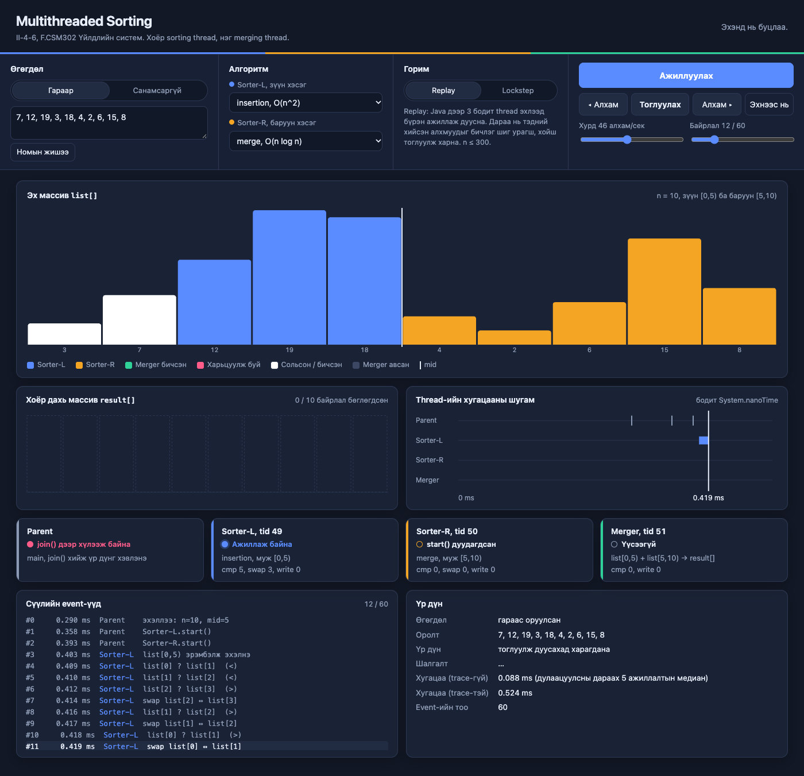
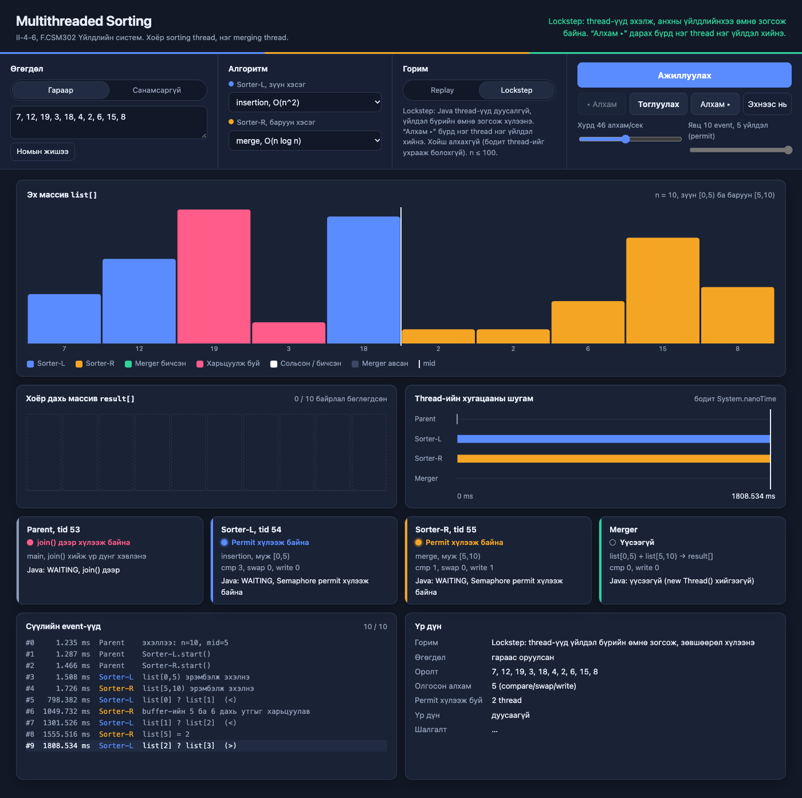

# II-4-6 · Multithreaded Sorting Application

Хичээл: F.CSM302 Үйлдлийн систем · Бие даалт 1, Бие даалт 2 (шүүмжийн дагуу эцэслэсэн хувилбар)
Хуваарилалтын код: II-4-6
Эх сурвалж: Silberschatz, Galvin, Gagne — Operating System Concepts, 10th ed. (2018), Chapter 4 "Threads & Concurrency", Programming Projects — Multithreaded Sorting Application

## Зорилго

Бүхэл тоон жагсаалтыг хоёр хэсэгт хувааж, **хоёр sorting thread** тус бүр нэг хэсгийг эрэмбэлнэ. Дараа нь **гурав дахь merging thread** хоёр эрэмбэлэгдсэн хэсгийг эх массивтай ижил хэмжээтэй хоёр дахь global массив руу нэгтгэнэ. Parent thread бүх thread-ийг `join` хийж дууссаны дараа үр дүнг хэвлэнэ.

Мөн бодит thread-ийн ажиллагааг удирдаж, харуулах **Sorting animation** UI хийнэ.





## Quick Start

JDK 17 буюу түүнээс дээш хувилбар шаардлагатай (`javac -version` гэж шалгана).

```bash
git clone https://github.com/Munkhgerelt/F.CSM302-TeamProject-2-4-6.git
cd F.CSM302-TeamProject-2-4-6
./build.sh
./run.sh --file examples/book-example.txt
./run.sh --web
```

Сүүлийн командыг ажиллуулсны дараа хөтөч дээр **http://localhost:8080** хаягийг нээнэ. Серверийг `Ctrl+C`-ээр зогсооно. Автомат тестийг `./test.sh` ажиллуулна (114 тест, үр дүн нь `tests/results/test-results.md`-д бичигдэнэ).

Хугацааны хэмжилтийг `./bench.sh` ажиллуулна (1–3 минут, үр дүн нь `tests/results/benchmark.md`-д бичигдэнэ).

Windows дээр `build.bat`, `run.bat`, `test.bat`, `bench.bat` скриптийг ашиглана.

Дэлгэрэнгүй заавар [docs/Manual.md](docs/Manual.md)-д байгаа. LaTeX хувилбар нь [docs/manual/manual.tex](docs/manual/manual.tex), PDF нь [docs/manual/manual.pdf](docs/manual/manual.pdf).

## Боломжууд

- Гурван бодит Java `Thread` (Sorter-L, Sorter-R, Merger) болон Parent thread дээрх `start()` / `join()`.
- Thread бүрд эхлэх, төгсөх индексийг параметрээр дамжуулна.
- 5 алгоритм: `insertion`, `bubble`, `selection`, `merge`, `quick`. Зүүн ба баруун хэсэгт өөр өөр алгоритм сонгож болно.
- Оролт гараас, файлаас эсвэл санамсаргүйгээр (`random`, `sorted`, `reversed`, `duplicates`) өгнө.
- Web UI-д хоёр горим байна:
  - **Replay:** бүртгэсэн бодит event-үүдийг урагш, хойш тоглуулна.
  - **Lockstep:** амьд thread-үүдийг `Semaphore`-оор нэг үйлдлээр урагшлуулна.
- Run, Step, Pause, Reset, хурд болон байрлалын удирдлагатай.
- Хоёр хэсэг өөр өнгөөр, merge тусдаа өнгөөр харагдана. Мөн legend, thread-ийн төлөв, хугацааны шугам, үр дүн, хугацаа гарна.
- JSON event trace (`--trace FILE`).

## БД2: шүүмжийн дагуу хийсэн сайжруулалт

IV-2-13 багийн шүүмжийн (F-01–F-09) дагуу:

- **F-01:** Replay ажиллаж байхад горимыг Lockstep болгоход гардаг алдааг (хоцорсон хариу) засав.
- **F-02:** Оролтын алдаа, сервертэй холбогдоогүй, хуудасны дотоод алдааг ялгаж мэдээлдэг болов.
- **F-03:** Зэрэг 4 Lockstep session-ий хязгаар хэвээр; хаагдсан session шалтгаанаа хэлдэг болов.
- **F-04, F-08:** Lockstep дээр «Явц: N event, M үйлдэл (permit)», картад «Permit хүлээж байна» гэж харуулна.
- **F-05:** `favicon.ico` 404 алдааг арилгав.
- **F-06:** `1,,2` гэх мэт хоосон утгыг алгасахдаа тэмдэглэл гаргадаг болов.
- **F-07:** Web сервер ба оролтын 14 автомат тест нэмэв (нийт 114). Гадны dependency нэмээгүй.

Засварын өмнөх ба дараах тест, дэлгэцийн зураг, хугацааны хэмжилт: [tests/results/bd2-evidence/README.md](tests/results/bd2-evidence/README.md). Release: https://github.com/Munkhgerelt/F.CSM302-TeamProject-2-4-6/releases

## Хязгаарлалт

| Зүйл | Хязгаар |
|---|---|
| Утга | int муж (−2 147 483 648 … 2 147 483 647) |
| O(n²) алгоритм (insertion, bubble, selection) | n ≤ 20 000 (`--force`-оор давж болно) |
| O(n log n) алгоритм (merge, quick) | n ≤ 1 000 000 |
| `--trace` | O(n²) алгоритмтай бол n ≤ 1 000, merge/quick бол n ≤ 10 000 |
| Web UI animation (Replay) | n ≤ 300 |
| Web UI Lockstep | n ≤ 100 |

Сондгой n-ийг зөвшөөрнө: зүүн хэсэг ⌈n/2⌉, баруун хэсэг ⌊n/2⌋ элементтэй.

## Технологи

- Java 17 буюу түүнээс дээш (зөвхөн стандарт сан, гадны dependency байхгүй)
- UI: `com.sun.net.httpserver` дээрх локал сервер + framework-гүй HTML/JS

## Хавтасны бүтэц

| Хавтас / файл | Агуулга |
|---|---|
| `src/main/java/sorting/` | Эх код. Дотор нь `algo/` (алгоритмууд), `core/` (thread-үүд), `input/` (оролт, хязгаар), `trace/` (event trace), `web/` (сервер) |
| `src/main/resources/web/` | Sorting animation (`index.html`, `app.js`, `style.css`) |
| `tests/` | Автомат тест (`TestRunner.java`), хугацааны хэмжилт (`Benchmark.java`) болон үр дүнгийн хүснэгт (`results/`) |
| `tests/results/bd2-evidence/` | БД2: засварын өмнөх ба дараах тестийн гаралт, дэлгэцийн зураг, хэмжилт |
| `examples/` | Жишээ болон тестийн өгөгдөл |
| `docs/` | Manual (Markdown, LaTeX, PDF) болон БД1-ийн дэлгэцийн зургууд |
| `report/` | БД1-ийн LaTeX тайлан |
| `build.*`, `run.*`, `test.*`, `bench.*` | Build, ажиллуулах, тестлэх, хэмжих скриптүүд (macOS/Linux: `.sh`, Windows: `.bat`) |

## Багийн гишүүд

| Нэр | Оюутны код |
|---|---|
| Б. Отгондалай | B241940132 |
| М. Мөнхгэрэлт | B232270012 |
| А. Базарсад | B242270065 |
| Б. Хаш-Эрдэнэ | B241930006 |
| Э. Мичидмаа | B221960015 |
| Ж. Суварнабазар | B251940118 |

## AI ашигласан тухай тэмдэглэл

Энэхүү төслийн код, тест, баримт бичиг болон тайлангийн нооргийг бэлтгэх, алгоритмын ажиллагааг тайлбарлах, алдаа засварлахад Claude хиймэл оюун ухааныг ашигласан. Багийн гишүүд бүх материалыг уншиж, шалган засварлаж, програмыг өөрсдийн компьютер дээр ажиллуулж баталгаажуулсан.
