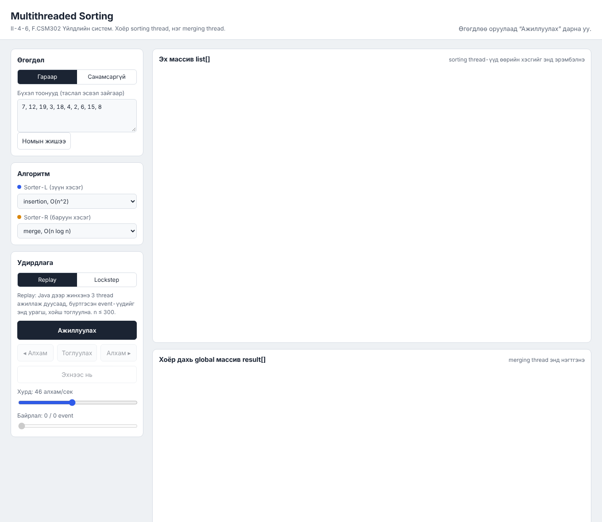
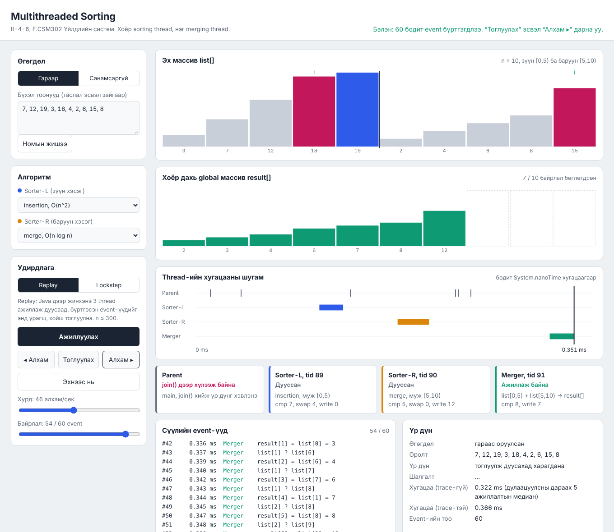
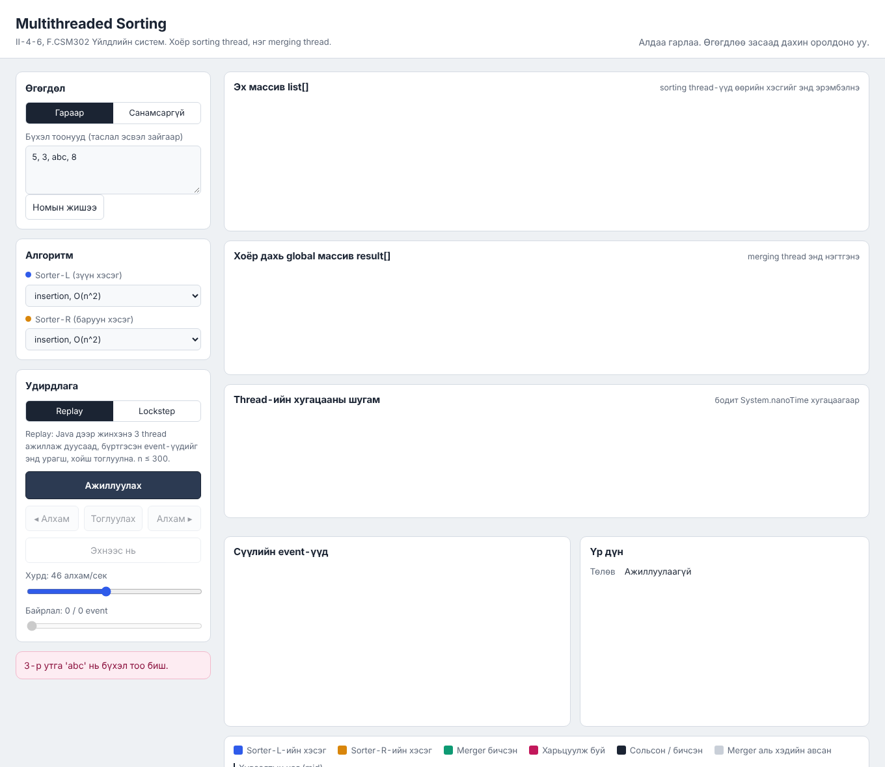

# II-4-6 Multithreaded Sorting Application: Гарын авлага

**Сургууль:** Шинжлэх Ухаан Технологийн Их Сургууль, Мэдээлэл, Холбооны Технологийн Сургууль  
**Хичээл:** F.CSM302 Үйлдлийн систем, Бие даалт 1  
**Сэдэв:** Multithreaded Sorting Application, Sorting animation (*Operating System Concepts*, 10th ed., Chapter 4, Programming Projects)  
**Хуваарилалтын код:** II-4-6  
**Хичээл заасан багш:** Г. Ганбат /F.CS10/  
**Гүйцэтгэсэн оюутнууд:** Б. Отгондалай /B241940132/, М. Мөнхгэрэлт /B232270012/, А. Базарсад /B242270065/, Б. Хаш-Эрдэнэ /B241930006/, Э. Мичидмаа /B221960015/, Ж. Суварнабазар /B251940118/

Энэ гарын авлага хоёр хэсэгтэй.

- **1. Хэрэглэгчийн заавар:** програмыг ашиглах хүнд зориулсан. Оролт оруулах, ажиллуулах, animation удирдах, өнгө ба төлөвийг унших, түгээмэл алдааг засахыг тайлбарлана.
- **2. Operational заавар:** төслийг шинэ машин дээр татаж, build хийж, тест ажиллуулж, үр дүнг шалгах хүнд (багш, шалгагч, багийн гишүүн) зориулсан.

---

## Агуулга

**1. Хэрэглэгчийн заавар**

- [1.1 Програмын зорилго](#11-програмын-зорилго)
- [1.2 Дэмжих орчин](#12-дэмжих-орчин)
- [1.3 Суулгах, нээх](#13-суулгах-нээх)
- [1.4 Оролт ба тохиргоо](#14-оролт-ба-тохиргоо)
- [1.5 Ажиллуулах, зогсоох, reset хийх](#15-ажиллуулах-зогсоох-reset-хийх)
- [1.6 Дүрслэлийн тэмдэг, өнгө, төлөв](#16-дүрслэлийн-тэмдэг-өнгө-төлөв)
- [1.7 Жишээ](#17-жишээ)
- [1.8 Түгээмэл алдаа ба шийдэл](#18-түгээмэл-алдаа-ба-шийдэл)
- [1.9 Хязгаарлалт](#19-хязгаарлалт)

**2. Operational заавар**

- [2.1 Repository clone хийх](#21-repository-clone-хийх)
- [2.2 OS, compiler/runtime, хувилбар](#22-os-compilerruntime-хувилбар)
- [2.3 Dependency суулгах](#23-dependency-суулгах)
- [2.4 Build ба Run](#24-build-ба-run)
- [2.5 Үндсэн тестийн өгөгдөл](#25-үндсэн-тестийн-өгөгдөл)
- [2.6 Автомат тест ба хүлээгдсэн үр дүн](#26-автомат-тест-ба-хүлээгдсэн-үр-дүн)
- [2.7 Нэмэлт boundary ба error тест](#27-нэмэлт-boundary-ба-error-тест)
- [2.8 Event trace (JSON)](#28-event-trace-json)
- [2.9 Known issues (мэдэгдэж буй асуудал)](#29-known-issues-мэдэгдэж-буй-асуудал)
- [2.10 Файлын бүтэц](#210-файлын-бүтэц)
- [2.11 Нөөц ба эх сурвалж](#211-нөөц-ба-эх-сурвалж)

---

# 1. Хэрэглэгчийн заавар

## 1.1 Програмын зорилго

Програм бүхэл тоон жагсаалтыг **гурван бодит Java thread** ашиглан эрэмбэлнэ.

1. **Parent thread** жагсаалтыг хоёр хэсэгт хуваана. Зүүн хэсэг нь `[0, mid)`, баруун хэсэг нь `[mid, n)` бөгөөд `mid = ⌈n/2⌉` байна.
2. **Sorter-L** ба **Sorter-R** гэсэн хоёр sorting thread зэрэг эхэлж, тус бүр өөрийн хэсгийг сонгосон алгоритмаар эрэмбэлнэ. Thread бүр эхлэх, төгсөх индексээ параметрээр авна.
3. Parent хоёр sorter-ийг `join()` хийсний дараа **Merger** thread-ийг эхлүүлнэ. Merger эрэмбэлэгдсэн хоёр хэсгийг **ижил хэмжээтэй хоёр дахь global массив** `result[]` руу нэгтгэнэ.
4. Parent Merger-ийг `join()` хийгээд үр дүнг хэвлэнэ.

Програмыг хоёр янзаар ашиглана.

- **Командын мөр (CLI):** үр дүн, thread бүрийн статистик, хугацааг terminal дээр хэвлэнэ.
- **Web UI (Sorting animation):** хөтөч дээр массивыг багана хэлбэрээр харуулж, thread бүрийн алхмыг өнгөөр ялгана. Энэ animation нь зохиомол биш. Бодит thread-ийн хийсэн үйлдэл бүрийг event болгон бүртгэж, түүнийгээ харуулдаг.



## 1.2 Дэмжих орчин

| Зүйл | Шаардлага |
|---|---|
| Java | **JDK 17** буюу түүнээс дээш (зөвхөн JRE хангалтгүй, `javac` хэрэгтэй) |
| OS | macOS, Linux, Windows (Windows-ийн скриптийг бодит машин дээр туршаагүй, [2.9](#29-known-issues-мэдэгдэж-буй-асуудал)-ыг үзнэ үү) |
| Хөтөч | Web UI-д: Chrome, Edge, Firefox, Safari-ийн сүүлийн хувилбар |
| Гадны сан | Хэрэггүй (Maven, Gradle, JUnit, npm ашиглаагүй) |
| Сүлжээ | Хэрэггүй. Web сервер зөвхөн `127.0.0.1` дээр сонсоно |

## 1.3 Суулгах, нээх

**macOS (Homebrew):**

```bash
brew install --cask temurin@17
export JAVA_HOME=$(/usr/libexec/java_home -v 17)
javac -version
```

**Linux (Debian/Ubuntu):**

```bash
sudo apt install openjdk-17-jdk
javac -version
```

**Windows:** https://adoptium.net хаягаас Temurin 17 (JDK)-г суулгаж, суулгах үед “Set JAVA_HOME” болон “Add to PATH” сонголтыг идэвхжүүлнэ. Дараа нь шинэ Command Prompt нээгээд `javac -version` гэж шалгана.

`javac -version` нь `javac 17.x` (эсвэл түүнээс дээш) гэж харуулах ёстой. Дараа нь төслийн хавтсанд:

```bash
./build.sh
```

`Build OK (javac 17) -> out/` гэж гарвал бэлэн. Windows дээр `build.bat` ажиллуулна.

## 1.4 Оролт ба тохиргоо

### Оролтын дүрэм

- Зөвхөн **бүхэл тоо** (int муж: −2 147 483 648 … 2 147 483 647).
- Тусгаарлагч: таслал `,`, цэг таслал `;`, зай эсвэл шинэ мөр. Давхар таслалыг (`1,,2`) хоосон зай гэж үзээд алгасна.
- Сөрөг тоо (`-5`) болон `+` тэмдэг (`+3`) зөвшөөрнө.
- Файлд `#` тэмдгээс хойших бичвэр тайлбар гэж тооцогдоно.
- Давхардсан утга зөвшөөрнө.
- **Сондгой n** зөвшөөрнө. Зүүн хэсэг ⌈n/2⌉, баруун хэсэг ⌊n/2⌋ элементтэй болно. Жишээ нь n = 11 үед 6 ба 5 элемент.

### CLI сонголтууд

| Сонголт | Утга |
|---|---|
| `--input "a,b,c"` | Тоонуудыг шууд оруулах |
| `a b c ...` | Тоонуудыг аргумент болгон оруулах |
| `--file PATH` | Текст файлаас унших |
| `--random N` | N ширхэг санамсаргүй тоо үүсгэх |
| `--seed S` | Санамсаргүй тооны seed (ижил seed бол ижил жагсаалт) |
| `--min A --max B` | Санамсаргүй утгын муж (анхдагч 1..100) |
| `--pattern P` | `random`, `sorted`, `reversed`, `duplicates` |
| `--algo NAME` | Хоёр sorter-т ижил алгоритм (анхдагч `merge`) |
| `--algo-left NAME` | Sorter-L-ийн алгоритм |
| `--algo-right NAME` | Sorter-R-ийн алгоритм |
| `--list-algos` | Боломжит алгоритмын жагсаалт |
| `--force` | O(n²) алгоритмын n ≤ 20 000 хязгаарыг үл тоох |
| `--full` | n > 50 үед ч массивыг бүтнээр хэвлэх |
| `--trace FILE` | Бүх алхмыг JSON event trace болгон хадгалах ([2.8](#28-event-trace-json)) |
| `--web [--port P]` | Web UI-г эхлүүлэх (анхдагч порт 8080) |
| `-h`, `--help` | Тусламж |

Оролтын эх үүсвэрээс (`--input`, тоонууд, `--file`, `--random`) **яг нэгийг** өгнө.

### Алгоритмууд

| Нэр | Алгоритм | Хүндрэл |
|---|---|---|
| `insertion` | Insertion sort | O(n²) |
| `bubble` | Bubble sort (эрт зогсолттой) | O(n²) |
| `selection` | Selection sort | O(n²) |
| `merge` | Merge sort (top-down, туслах буфертэй) | O(n log n) |
| `quick` | Quick sort (Hoare partition, дунд pivot) | O(n log n) дундаж |

Зүүн ба баруун sorter-т **өөр өөр** алгоритм сонгож болно.

### Web UI-ийн тохиргоо

| Хэсэг | Талбар | Тайлбар |
|---|---|---|
| Өгөгдөл | Гараар / Санамсаргүй | Өгөгдлийн эх үүсвэр |
| | Бүхэл тоонууд | Гараар оруулах жагсаалт. “Номын жишээ” товч номын жишээг бөглөнө |
| | n, Seed, Min, Max, Хэлбэр | Санамсаргүй жагсаалт үүсгэх тохиргоо |
| Алгоритм | Sorter-L, Sorter-R | Хэсэг тус бүрийн алгоритм |
| Горим | Replay / Lockstep | Ажиллах горим (1.5-р хэсэгт тайлбарласан) |

## 1.5 Ажиллуулах, зогсоох, reset хийх

### Командын мөр

```bash
./run.sh --input "7,12,19,3,18,4,2,6,15,8"
```

Гаралт:

```text
Оролт: гараас оруулсан
Эх жагсаалт (n=10): [7, 12, 19, 3, 18, 4, 2, 6, 15, 8]
Хуваалт: зүүн [0,5) хэмжээ 5, баруун [5,10) хэмжээ 5
[Sorter-L] tid=18 муж=[0,5) merge: compare=7 swap=0 write=12, 1.347-1.391 ms
[Sorter-R] tid=19 муж=[5,10) merge: compare=5 swap=0 write=12, 1.538-1.549 ms
[Merger] tid=20 нэгтгэл list[0,5) + list[5,10) -> result[0,10): compare=8 write=10, 2.483-2.514 ms
Parent thread бүх thread-ийг join хийлээ.
Эрэмбэлсэн үр дүн: [2, 3, 4, 6, 7, 8, 12, 15, 18, 19]
Шалгалт (Arrays.sort-той харьцуулав): ЗӨВ
Хугацаа: эрэмбэлэх үе 1.574 ms, нийт 2.550 ms
```

Мөр бүрийн утга:

- `tid`: Java thread-ийн дугаар. Гурван thread гурван өөр дугаартай байгаа нь тэд тусдаа thread гэдгийг харуулна.
- `муж`: thread-д параметрээр дамжуулсан индексийн муж.
- `compare / swap / write`: тухайн thread-ийн хийсэн үйлдлийн тоо.
- `1.347-1.391 ms`: run эхэлснээс хойш тухайн thread эхэлсэн ба дууссан хугацаа.
- `Шалгалт`: үр дүнг `java.util.Arrays.sort`-той харьцуулсан дүн.

CLI ажиллаад дуусахдаа өөрөө зогсоно. Exit code нь:
- `0`: амжилттай
- `1`: үр дүн буруу (хэвийн үед гарахгүй)
- `2`: оролтын алдаа

### Web UI (Sorting animation)

```bash
./run.sh --web
```

Terminal дээр `Sorting animation сервер ажиллаж байна: http://localhost:8080/` гэж гарна. Хөтөч дээр **http://localhost:8080** хаягийг нээнэ.

- Өөр порт ашиглах: `./run.sh --web --port 8100`
- **Зогсоох:** серверийг ажиллуулсан terminal дээр `Ctrl+C`.
- Хөтчийн цонхыг хаахад ажиллаж буй Lockstep session автоматаар цуцлагдана.

### Хоёр горим

| | **Replay** | **Lockstep** |
|---|---|---|
| Юу болдог | Java дээр 3 бодит thread бүрэн ажиллаж дуусна. Бүртгэсэн event-үүдийг хөтөч дээр тоглуулна | Java thread-үүд **амьд** хэвээр байна. Үйлдэл бүрийн өмнө `Semaphore`-ийн permit хүлээж, бодитоор `WAITING` төлөвт зогсоно |
| “Алхам ▸” | Дараагийн бүртгэсэн event-ийг харуулна | Серверт нэг permit өгнө, нэг thread яг **нэг** үйлдэл хийнэ |
| Хойш алхах | Болно (◂ Алхам, Байрлал гулсуур) | **Болохгүй**, бодит thread-ийг буцааж болдоггүй |
| Хугацаа | Бодит хурдыг харуулна | Таны товч дарах хоорондын хугацааг багтаана |
| Хамгийн их n | 300 | 100 |

Хурд хэмжих бол **Replay** горимыг ашиглана. Thread-ийн төлөвийг (`WAITING`, `RUNNABLE`, `TERMINATED`) бодитоор харах бол **Lockstep** горимыг ашиглана.

### Товч ба удирдлага

| Удирдлага | Үйлдэл | Гарын товч |
|---|---|---|
| **Ажиллуулах** | Java дээр шинэ run эхлүүлнэ | |
| **Тоглуулах / Түр зогсоох** | Тасралтгүй тоглуулах эсвэл зогсоох | `Space` |
| **Алхам ▸** | Нэг алхам урагшлах | `→` |
| **◂ Алхам** | Нэг алхам хойшлох (зөвхөн Replay) | `←` |
| **Эхнээс нь** | Replay: эхлэл рүү буцна. Lockstep: шинэ session эхлүүлнэ | |
| **Хурд** | 1-ээс 5000 алхам/сек (логарифм шкал) | |
| **Байрлал** | Гулсуураар дурын event рүү үсрэх (зөвхөн Replay) | |

Горимыг солиход өмнөх дүрслэл цэвэрлэгдэж, ажиллаж байсан Lockstep session цуцлагдана. Дараа нь “Ажиллуулах”-ыг дахин дарна.

## 1.6 Дүрслэлийн тэмдэг, өнгө, төлөв

### Баганы өнгө

| Өнгө | Утга |
|---|---|
| 🟦 Цэнхэр | Sorter-L-ийн хэсэг `[0, mid)` |
| 🟧 Улбар шар | Sorter-R-ийн хэсэг `[mid, n)` |
| 🟩 Ногоон | Merger-ийн `result[]`-д бичсэн утга |
| 🟥 Ягаан улаан | Яг одоо харьцуулж буй элементүүд |
| ⬛ Хар | Яг одоо сольсон эсвэл бичсэн элемент |
| ⬜ Саарал | Merger аль хэдийн авсан элемент |
| Босоо хар зураас | Хуваалтын цэг `mid` |

Merger ажиллах үед `list[]` дээр `i` (зүүн хэсгийн заагч), `j` (баруун хэсгийн заагч) тэмдэг гарна.

### Дэлгэцийн хэсгүүд

1. **Дээд самбар:** өгөгдөл, алгоритм, горим, удирдлагын товчнууд, хурд ба байрлалын гулсуур.
2. **Эх массив `list[]`:** хоёр sorter өөрийн хэсгийг энд эрэмбэлнэ.
3. **Хоёр дахь global массив `result[]`:** Merger энд нэгтгэнэ.
4. **Thread-ийн хугацааны шугам:** thread бүр хэзээ ажилласныг бодит `System.nanoTime` хугацаагаар харуулна. Parent-ийн мөрөнд `start()` / `join()` агшнууд босоо зураасаар гарна.
5. **Thread-ийн картууд:** нэр, `tid`, төлөв, муж, үйлдлийн тоо.
6. **Сүүлийн event-үүд:** сүүлд болсон алхмууд. Thread бүр өөрийн өнгөтэй.
7. **Үр дүн:** оролт, эрэмбэлсэн үр дүн, шалгалт, хугацаа (trace-тэй ба trace-гүй), event-ийн тоо.

### Thread-ийн төлөв (картууд)

| Төлөв | Утга |
|---|---|
| Үүсээгүй | Thread объект хараахан үүсээгүй |
| start() дуудагдсан | Parent `start()` дуудсан, thread эхэлж амжаагүй |
| Ажиллаж байна | Thread өөрийн ажлыг хийж байна |
| join() дээр хүлээж байна | (Parent) хүүхэд thread-ээ дуусахыг хүлээж байна |
| Дууссан | Thread-ийн `run()` дууссан |

**Lockstep** горимд карт дээр нэмэлт **Java төлөв** (`Thread.getState()`) гарна.

| Java төлөв | Утга |
|---|---|
| `NEW` | `new Thread()` хийгдсэн, `start()` дуудаагүй |
| `RUNNABLE` | Ажиллаж байна |
| `WAITING` | Sorter/Merger: Semaphore permit хүлээж байна. Parent: `join()` дээр хүлээж байна |
| `TERMINATED` | Дууссан |

## 1.7 Жишээ

### Жишээ 1. Номын жишээ (Web UI, Replay)

1. `./run.sh --web` ажиллуулж, http://localhost:8080 хаягийг нээнэ.
2. “Номын жишээ” товчийг дарна. Жагсаалт: `7, 12, 19, 3, 18, 4, 2, 6, 15, 8`.
3. Sorter-L-д `insertion`, Sorter-R-д `merge` сонгоно.
4. **Ажиллуулах** → **Алхам ▸**-ийг хэд дарж, Sorter-L өөрийн хэсгийг insertion sort-оор эрэмбэлж буйг харна.


5. **Байрлал** гулсуурыг төгсгөл рүү чирвэл Merger `result[]`-ийг ногооноор бөглөж буй нь харагдана.



6. Төгсгөлд нь `result[] = 2 3 4 6 7 8 12 15 18 19`, Шалгалт: “Эрэмбэлэгдсэн, зөв”.


### Жишээ 2. Сондгой n ба өөр алгоритм (CLI)

```bash
./run.sh --file examples/odd-11.txt --algo-left bubble --algo-right quick
```

Хүлээгдэх үр дүн:
- `Тэмдэглэл: n = 11 сондгой тул зүүн хэсэг 6, баруун хэсэг 5 элементтэй`
- `Хуваалт: зүүн [0,6) хэмжээ 6, баруун [6,11) хэмжээ 5`
- `Эрэмбэлсэн үр дүн: [1, 2, 3, 4, 5, 6, 7, 8, 9, 10, 11]`
- `Шалгалт ... ЗӨВ`

### Жишээ 3. Санамсаргүй 60 тоо (Web UI)

“Санамсаргүй” сонгож n = 60, Seed = 42, Sorter-L = `bubble`, Sorter-R = `quick` гэж тохируулаад Ажиллуулна. Хоёр sorter-ийн хугацааны шугам давхцаж байгаа нь тэд **зэрэг** ажилласныг харуулна.


### Жишээ 4. Lockstep горим

1. Дээд самбарын “Горим” хэсэгт **Lockstep** сонгоно.
2. **Ажиллуулах** дарна. Карт дээр Sorter-L ба Sorter-R: `Java: WAITING, Semaphore permit хүлээж байна`, Parent: `Java: WAITING, join() дээр` гэж гарна.
3. **Алхам ▸** бүрд нэг thread нэг үйлдэл хийнэ. Fair (FIFO) semaphore ашигладаг тул хоёр sorter ээлжилнэ (L, R, L, R … эсвэл R, L, R, L …).
4. **Тоглуулах** дарвал хурдны тохиргооны дагуу permit-ийг тасралтгүй өгнө. Төгсгөлд бүх thread `TERMINATED` болно.


## 1.8 Түгээмэл алдаа ба шийдэл

| Алдааны мессеж | Шалтгаан | Шийдэл |
|---|---|---|
| `javac олдсонгүй` | JDK суугаагүй | [1.3](#13-суулгах-нээх)-ыг үзнэ үү |
| `JDK 17+ хэрэгтэй, гэтэл одоогийн javac хувилбар: 11` | Хуучин Java PATH-д байна | macOS: `export JAVA_HOME=$(/usr/libexec/java_home -v 17)` |
| `out/ олдсонгүй. Эхлээд ./build.sh ажиллуулна уу.` | Build хийгээгүй | `./build.sh` |
| `Оролтын өгөгдөл өгөөгүй байна` | Оролтын эх үүсвэр алга | `--input`, `--file` эсвэл `--random`-ийн аль нэгийг өгнө |
| `Оролт хоосон байна` | Хоосон жагсаалт | Дор хаяж нэг тоо оруулна |
| `3-р утга 'abc' нь бүхэл тоо биш.` | Тоо биш утга | Зөвхөн бүхэл тоо оруулна |
| `2-р утга '2.5' нь бутархай тоо.` | Бутархай тоо | Бүхэл тоо оруулна |
| `2-р утга '3000000000' нь int мужаас хэтэрсэн.` | Хэт том/бага тоо | −2 147 483 648 … 2 147 483 647 |
| `insertion нь O(n^2) алгоритм тул n ≤ 20000 ...` | O(n²)-д n хэт их | `merge`/`quick` сонгох, n багасгах, эсвэл `--force` |
| `'foo' гэсэн алгоритм байхгүй` | Алгоритмын нэр буруу | `--list-algos` |
| `Файл олдсонгүй: ...` | Файлын зам буруу | Замыг төслийн хавтсаас эхлэн бичнэ |
| `min (9) нь max (1)-аас их байж болохгүй.` | Муж буруу | min ≤ max |
| `8080 порт аль хэдийн ашиглагдаж байна` | Өөр програм (эсвэл өмнөх сервер) портыг эзэлсэн | `./run.sh --web --port 8100` эсвэл өмнөх серверийг `Ctrl+C`-ээр зогсооно |
| Хөтөч дээр `Сервертэй холбогдож чадсангүй` | Сервер зогссон | Terminal дээр `./run.sh --web` дахин ажиллуулна |
| `Lockstep session олдсонгүй` | Session 10 минут хөдөлгөөнгүй байсан эсвэл сервер дахин асаасан | “Ажиллуулах”-ыг дахин дарна |
| zsh: `command not found: #` | Командыг тайлбар (`#`)-тай нь хуулсан | Зөвхөн командын мөрийг хуулна |



## 1.9 Хязгаарлалт

| Зүйл | Хязгаар | Шалтгаан |
|---|---|---|
| Утга | int муж (−2 147 483 648 … 2 147 483 647) | Java `int` |
| O(n²) алгоритм (insertion, bubble, selection) | n ≤ 20 000 (`--force`-оор давж болно) | Удаан ажиллахаас сэргийлнэ |
| O(n log n) алгоритм (merge, quick) | n ≤ 1 000 000 | Санах ой, хугацаа |
| `--trace` O(n²) алгоритмтай | n ≤ 1 000 | Алхам бүр нэг event тул файл хэт томорно |
| `--trace` merge/quick | n ≤ 10 000 | Мөн адил |
| Web UI, Replay | n ≤ 300 | Animation уншигдахуйц байх |
| Web UI, Lockstep | n ≤ 100 | Алхам бүр серверт хүсэлт явуулна |
| Зэрэг Lockstep session | 4 | 10 минут хөдөлгөөнгүй session автоматаар цуцлагдана |

---

# 2. Operational заавар

## 2.1 Repository clone хийх

```bash
git clone https://github.com/Munkhgerelt/F.CSM302-TeamProject-2-4-6.git
cd F.CSM302-TeamProject-2-4-6
```

## 2.2 OS, compiler/runtime, хувилбар

| Орчин | OS | JDK | Үр дүн |
|---|---|---|---|
| Багийн гишүүний компьютер | macOS 27 (Apple Silicon, aarch64), 10 цөм | Eclipse Temurin 17.0.21+9 | Build OK, тест 100/100 |
| Хөгжүүлэлтийн Linux контейнер | Ubuntu 24.04 (amd64), 2 цөм | OpenJDK 21 (`--release 17`-оор хөрвүүлсэн) | Build OK, тест 100/100 |
| Windows | Туршаагүй | | [2.9](#29-known-issues-мэдэгдэж-буй-асуудал) |

`build.sh` нь `javac --release 17` ашигладаг. Тиймээс JDK 21 дээр build хийсэн ч Java 17-д ажиллах код гарна.

## 2.3 Dependency суулгах

Програм нь гадны ямар ч сан ашигладаггүй тул зөвхөн JDK 17 буюу түүнээс дээш хувилбар хэрэгтэй ([1.3](#13-суулгах-нээх)). Maven, Gradle, npm, JUnit суулгах шаардлагагүй. Web UI нь JDK-д багтсан `com.sun.net.httpserver`-ийг ашигладаг тул тусдаа web сервер ч хэрэггүй.

## 2.4 Build ба Run

| Үйлдэл | macOS / Linux | Windows |
|---|---|---|
| Build | `./build.sh` | `build.bat` |
| CLI | `./run.sh --input "7,12,19,3,18,4,2,6,15,8"` | `run.bat --input "7,12,19,3,18,4,2,6,15,8"` |
| Web UI | `./run.sh --web` | `run.bat --web` |
| Тест | `./test.sh` | `test.bat` |

Скрипт ажиллуулах эрхгүй бол `chmod +x build.sh run.sh test.sh` хийнэ.

`build.sh` нь:
1. `javac`-ийн хувилбарыг шалгана (17-оос доош бол алдаа өгч, зааварчилгаа хэвлэнэ).
2. `src/main/java` доторх бүх `.java` файлыг `out/` руу хөрвүүлнэ.
3. `src/main/resources/web` (HTML/CSS/JS)-ийг `out/` руу хуулна.

`out/`, `out-test/` хавтас, `.class` файлууд нь `.gitignore`-д орсон тул commit хийгдэхгүй.

## 2.5 Үндсэн тестийн өгөгдөл

`examples/` хавтсанд:

| Файл | Агуулга | Хүлээгдэх үр дүн |
|---|---|---|
| `book-example.txt` | Номын жишээ, n = 10 | `2 3 4 6 7 8 12 15 18 19` |
| `odd-11.txt` | Сондгой n = 11 | Хуваалт 6 / 5, `1 2 … 11` |
| `duplicates.txt` | Давхардсан утга, n = 12 | `1 1 1 2 2 3 3 3 3 5 5 5` |
| `reversed.txt` | Урвуу эрэмбэ, n = 10 | `1 2 … 10` |
| `int-limits.txt` | Сөрөг тоо, INT_MIN, INT_MAX | `-2147483648 -100 -1 0 0 7 100 2147483647` |
| `single.txt` | Ганц элемент | `42`, баруун хэсэг хоосон |
| `invalid-letters.txt` | `abc` агуулсан | Алдаа, exit code 2 |
| `invalid-overflow.txt` | `3000000000` | Алдаа, exit code 2 |
| `empty.txt` | Зөвхөн тайлбар | Алдаа, exit code 2 |

Санамсаргүй өгөгдлийг `--random N --seed S --pattern P` сонголтоор давтагдахуйц үүсгэнэ.

## 2.6 Автомат тест ба хүлээгдсэн үр дүн

```bash
./test.sh
```

Скрипт эхлээд build хийж, дараа нь `tests/TestRunner.java`-г хөрвүүлж ажиллуулна. JUnit ашиглаагүй, цэвэр Java 17. Ойролцоогоор 5–10 секунд ажиллана. Төгсгөлд нь:

```text
Нийт: 100, амжилттай: 100, алдаатай: 0
Хүснэгт: tests/results/test-results.md
```

`tests/results/test-results.md` файлд тест бүрийн **оролт, хүлээгдсэн утга, бодит утга, үр дүн** хүснэгтээр бичигдэнэ. Хүлээгдсэн утгыг тестийн кодонд урьдчилан бичсэн бөгөөд бодит утга нь програмыг ажиллуулж гарсан үр дүн юм. Бүх тест амжилттай бол exit code 0, үгүй бол 1.

| Ангилал | Тоо | Шалгах зүйл |
|---|---:|---|
| Номын жишээ | 26 | 5 × 5 = 25 алгоритмын хослол, хуваалт ба хоёр хэсэг |
| Захын тохиолдол | 17 | n = 1, 2, 3, бүгд ижил, сөрөг, INT_MIN/MAX, эрэмбэтэй/урвуу, ⌈n/2⌉/⌊n/2⌋ |
| Буруу оролт | 18 | Хоосон, тоо биш, бутархай, int-ээс гадуур, O(n²)/trace/дээд хязгаар, буруу файл |
| Давхардал ба хэлбэр | 6 | 4 хэлбэр × 25 хослол, 2000 санамсаргүй ажиллагаа |
| Том өгөгдөл | 4 | n = 1 000 000 (merge/quick), n = 20 000 (O(n²)) |
| Thread | 5 | 3 тусдаа thread, параметр, TERMINATED, Merger-ийн дараалал, муж зөрчөөгүй |
| Event trace | 7 | Replay = бодит үр дүн, JSON формат, Parent-ийн event дараалал |
| Lockstep | 5 | WAITING, 1 permit = 1 үйлдэл, L/R ээлжлэх, дуусах, цуцлах |
| Командын мөр | 12 | Тусдаа JVM дээр гаралт ба exit code |

## 2.7 Нэмэлт boundary ба error тест

Шалгагч дараах командуудыг нэг нэгээр нь ажиллуулж үр дүнг харьцуулж болно.

| Команд | Хүлээгдэх үр дүн | Exit |
|---|---|---|
| `./run.sh --file examples/book-example.txt` | `[2, 3, 4, 6, 7, 8, 12, 15, 18, 19]`, ЗӨВ | 0 |
| `./run.sh 42` | `[42]`, “баруун хэсэг хоосон” тэмдэглэл | 0 |
| `./run.sh 2 1` | `[1, 2]` | 0 |
| `./run.sh 3 1 2` | `[1, 2, 3]`, хуваалт 2 / 1 | 0 |
| `./run.sh --file examples/duplicates.txt` | `[1, 1, 1, 2, 2, 3, 3, 3, 3, 5, 5, 5]` | 0 |
| `./run.sh --random 20 --pattern sorted --algo bubble` | Эрэмбэтэй жагсаалт, ЗӨВ | 0 |
| `./run.sh --random 20 --pattern reversed --algo insertion` | ЗӨВ | 0 |
| `./run.sh --random 1000000 --seed 1 --algo quick` | ЗӨВ (секундээс бага) | 0 |
| `./run.sh` | `Оролтын өгөгдөл өгөөгүй байна` | 2 |
| `./run.sh --input ""` | `Оролт хоосон байна` | 2 |
| `./run.sh --input "5,3,abc"` | `3-р утга 'abc' нь бүхэл тоо биш.` | 2 |
| `./run.sh --input "1,2.5"` | Бутархай тооны алдаа | 2 |
| `./run.sh --input "1,3000000000"` | int мужийн алдаа | 2 |
| `./run.sh --random 20001 --algo insertion` | O(n²) хязгаарын алдаа | 2 |
| `./run.sh --random 20001 --algo insertion --force` | Анхааруулга, ЗӨВ | 0 |
| `./run.sh --random 5 --min 9 --max 1` | `min (9) нь max (1)-аас их байж болохгүй.` | 2 |
| `./run.sh --input "1,2" --algo foo` | `'foo' гэсэн алгоритм байхгүй` | 2 |

Exit code-ийг `echo $?` (Windows: `echo %errorlevel%`)-ээр харна.

## 2.8 Event trace (JSON)

```bash
./run.sh --file examples/book-example.txt --algo-left insertion --algo-right quick --trace book.trace.json
```

Бүх алхмыг `book.trace.json` файлд `ii-4-6-trace/1` форматаар хадгалж, terminal дээр event-ийн тоог төрлөөр болон thread-ээр хэвлэнэ. `*.trace.json` файлууд `.gitignore`-д орсон.

Файлын бүтэц:
- `format`, `n`, `mid`, `algorithms`, `input`, `result`, `sorted`
- `threads`: thread бүрийн нэр, tid, муж, үйлдлийн тоо, эхэлсэн/дууссан хугацаа
- `timing`:
  - `tracedTotalNs`: trace-тэй ажилласан хугацаа
  - `untracedTotalNs`: trace-гүй, 2 дулаацуулалтын дараах 3 ажиллалтын медиан
- `eventCounts`, `eventCount`, `truncated`
- `events`: `{seq, t, th, type, a, b, c, note}` объектуудын жагсаалт

| type | thread | Утга |
|---|---|---|
| `RUN_START`, `START`, `JOIN`, `RUN_END` | Parent | Run эхлэх, `start()`, `join()`, дуусах |
| `T_START`, `T_DONE` | Sorter | Хэсгээ эрэмбэлж эхэлсэн / дууссан |
| `CMP` | Sorter | `list[a]`-г `list[b]`-тэй харьцуулав, `c` = тэмдэг |
| `CMPV` | Sorter | `list[a]`-г утга `b` (pivot)-тэй харьцуулав |
| `CMPA` | Sorter | Merge sort-ын туслах буфер дахь харьцуулалт |
| `SWP` | Sorter | `list[a]` ↔ `list[b]` |
| `SET` | Sorter | `list[a] = b` |
| `M_START`, `M_DONE` | Merger | Нэгтгэл эхэлсэн / дууссан |
| `MCMP` | Merger | `list[a]` (зүүн) ба `list[b]` (баруун)-ийг харьцуулав |
| `MW` | Merger | `result[a] = list[b]`, `c` = бичсэн утга |

Trace-ийн event-үүдийг эх жагсаалт дээр дахин хэрэглэвэл (replay) бодит `result[]` яг гарч ирдэг. Үүнийг автомат тест шалгадаг.

## 2.9 Known issues (мэдэгдэж буй асуудал)

1. **Windows скрипт туршаагүй.** `build.bat`, `run.bat`, `test.bat`-ийг бичсэн боловч бодит Windows машин дээр ажиллуулж үзээгүй. Асуудал гарвал Command Prompt дээр гараар build хийж болно (хавтасны замд зай байхгүй үед):
   ```bat
   dir /s /b src\main\java\*.java > sources.txt
   javac --release 17 -encoding UTF-8 -d out @sources.txt
   xcopy /e /i /y src\main\resources out
   java -Dfile.encoding=UTF-8 -cp out sorting.Main --web
   ```
2. **Хугацааны хэмжилт шуугиантай.** n бага үед хугацаа миллисекундээс бага бөгөөд JVM-ийн JIT, thread үүсгэх зардал, OS-ийн scheduler-ээс хамаарч ажиллах бүрд өөр гарна. Мөн n бага үед thread үүсгэх зардал эрэмбэлэх ажлаас их байдаг тул Sorter-L Sorter-R эхлэхээс өмнө дуусчихсан байж болно. Энэ нь алдаа биш. Тиймээс CLI ба trace нь дулаацуулсны дараах медиан хугацааг тусад нь хэвлэдэг.
3. **Trace-тэй хугацаа удаан.** Event бүрийг бүртгэх зардлаас болж trace-тэй ажиллалт trace-гүйгээс удаан. Хурдыг харьцуулахдаа “trace-гүй” хугацааг ашиглана.
4. **Lockstep-д хойш алхах боломжгүй.** Бодит thread-ийг буцааж болохгүй. Мөн хугацааны тэмдэглэгээ нь хэрэглэгчийн товч дарах хоорондын хугацааг агуулна.
5. **Lockstep-ийн эхний permit.** Аль sorter нь gate-д түрүүлж хүрэх нь OS-ийн scheduler-ээс хамаарна. Түүнээс хойш fair semaphore хоёр sorter-ийг ээлжлүүлнэ.
6. **Web сервер зөвхөн локал.** `127.0.0.1` дээр сонсдог тул өөр компьютерээс нээгдэхгүй (аюулгүй байдлын үүднээс зориуд ингэсэн).

## 2.10 Файлын бүтэц

```text
F.CSM302-TeamProject-2-4-6/
├── README.md
├── build.sh, build.bat          хөрвүүлэх
├── run.sh, run.bat              ажиллуулах
├── test.sh, test.bat            автомат тест
├── src/main/java/sorting/
│   ├── Main.java, Config.java   CLI оролт, сонголт
│   ├── algo/                    5 эрэмбэлэх алгоритм
│   ├── core/                    SortingThread, MergingThread, MultithreadedSorter, StepGate, Ops ...
│   ├── input/                   InputParser, Limits, DataGenerator
│   ├── trace/                   TraceRecorder, TraceEvent, TraceJson
│   └── web/                     WebServer, LiveSession
├── src/main/resources/web/      index.html, app.js, style.css
├── tests/TestRunner.java        100 автомат тест
├── tests/results/               test-results.md
├── examples/                    тестийн өгөгдөл
├── docs/                        Manual.md, manual/manual.tex, images/
└── report/                      LaTeX тайлан
```

## 2.11 Нөөц ба эх сурвалж

- Repository: https://github.com/Munkhgerelt/F.CSM302-TeamProject-2-4-6
- Тайлан: `report/main.pdf`; тестийн үр дүн: `tests/results/test-results.md`; хэмжилт: `tests/results/benchmark.md`
- A. Silberschatz, P. B. Galvin, G. Gagne. *Operating System Concepts*, 10th ed., Wiley, 2018, Chapter 4
- Java SE 17 API: https://docs.oracle.com/en/java/javase/17/docs/api/
- Temurin JDK: https://adoptium.net

---

*Энэ гарын авлагын нооргийг Claude хиймэл оюун ухаан ашиглан бэлтгэсэн. Багийн гишүүд уншиж, командуудыг ажиллуулж шалгасан.*
